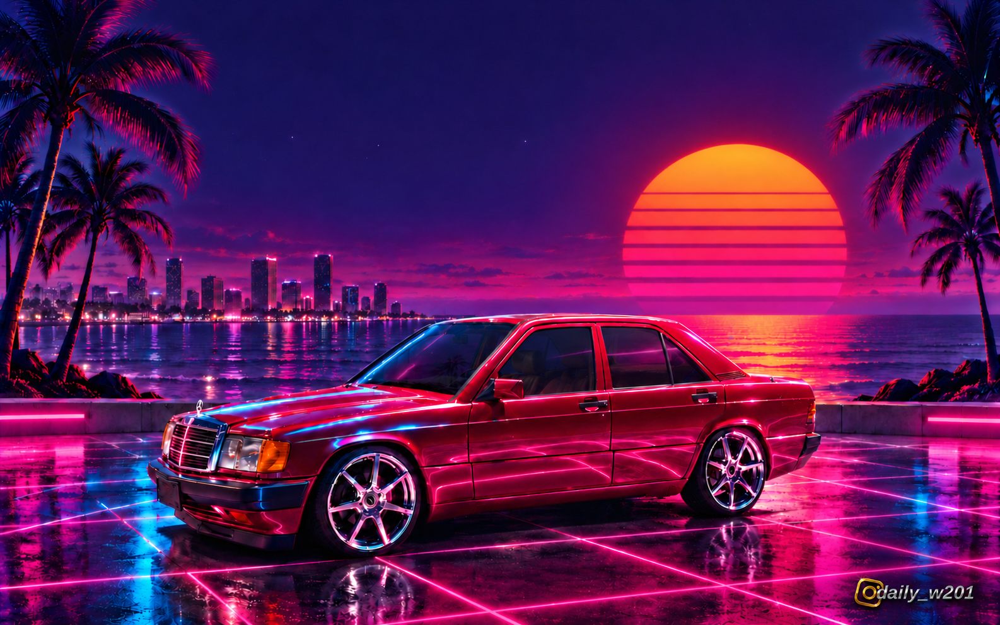

# Mercedes Vice

A dark synthwave theme for Omarchy: midnight indigo, neon cyan and pink, and a sunset-gradient window border. The wallpaper features a red Mercedes-Benz W201 beside a Miami-inspired waterfront, signed with a gold camera icon and chrome `daily_w201` lettering.



The preview above shows the wallpaper, not a desktop screenshot.

## Install

Install directly from this repository:

```sh
omarchy theme install https://github.com/BonEvil/omarchy-mercedes-vice-theme.git
```

Switch back to it later with:

```sh
omarchy theme set "Mercedes Vice"
```

## Included

- `colors.toml`: dark palette and sunset-gradient active window border. Omarchy generates application configs from this palette.
- `shell.bar.toml`: translucent indigo bar with pink accents, merged into the generated shell configuration.
- `backgrounds/mercedes-vice.png`: the approved wallpaper.
- `icons.theme`: selects Yaru-yellow, which must be installed on the target machine.
- `preview.png`: wallpaper preview for the theme switcher.

Prepared against the Omarchy installation on the author's machine in November 2026. Shell section overrides and gradient palette keys require an Omarchy version that supports them. No custom terminal or editor configuration is installed by this theme.

## Optional custom icons

The included Mercedes Vice icon set adds palm and sunset details and inherits missing icons from Yaru-yellow, Yaru, Adwaita and hicolor. The theme installer does not install this extra automatically.

Run from this repository's directory:

```sh
mkdir -p ~/.local/share/icons
cp -R extras/icons/Mercedes-Vice ~/.local/share/icons/
```

To select it for Mercedes Vice, replace the installed theme's `icons.theme` contents with `Mercedes-Vice` and reapply the theme:

```sh
printf '%s\n' Mercedes-Vice > ~/.config/omarchy/themes/mercedes-vice/icons.theme
omarchy theme set "Mercedes Vice"
```

If you installed to a different theme directory, use that path instead. A future theme update may reset this choice to Yaru-yellow. To undo, set that file back to `Yaru-yellow` and reapply.

## Optional Thunar colors

`extras/thunar.css` styles only Thunar. Other file managers do not need it. Omarchy does not apply this CSS automatically.

Copy it to `~/.config/gtk-3.0/mercedes-vice-thunar.css`, then add this line at the **beginning** of your existing `~/.config/gtk-3.0/gtk.css` (create the directory and file if needed):

```css
@import url("mercedes-vice-thunar.css");
```

Preserve your existing GTK CSS and restart Thunar to see the result. This is a user-wide override and persists when changing themes. Remove the import to undo it.

## Optional window transparency

For Omarchy's Lua-based Hyprland configuration, these personal rules can be added to `~/.config/hypr/hyprland.lua` after Omarchy's defaults:

```lua
o.window({ class = "^thunar$" }, { opacity = "0.90 override 0.86 override" })
o.window({ class = "^org[.]omarchy[.]btop$" }, { opacity = "0.90 override 0.86 override" })
```

These rules are optional and persist across themes. The btop rule matches Omarchy's btop launcher. Remove the lines to undo. They are documented rather than shipped as executable theme files.

## Artwork and license

The wallpaper was created with AI assistance using the author's car photographs as references, then edited to add the `daily_w201` signature. Source photographs and generation prompts are not included.

MIT licensed; see [LICENSE](LICENSE). Referenced external icon themes remain under their own licenses and are not bundled. Mercedes-Benz and Instagram are referenced descriptively; this is an independent community theme with no affiliation or endorsement.
